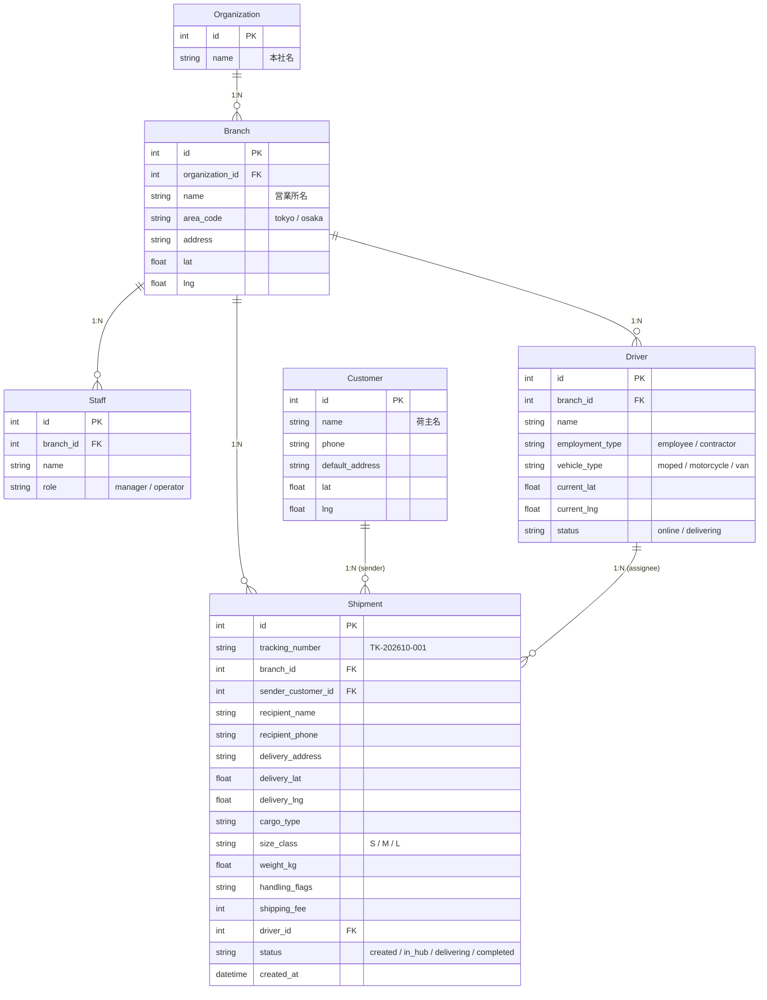

# Logistics TMS (Transport Management System)

> マルチ拠点対応・容積×重量 二軸物理制約エンジン搭載 ラストワンマイル輸配送管理システム

[](https://www.python.org/)
[](https://fastapi.tiangolo.com/)
[](https://www.sqlalchemy.org/)
[](https://leafletjs.com/)
[](https://tailwindcss.com/)
[](https://opensource.org/licenses/MIT)

会員登録不要の **4ロール切り替え**（本部・営業所・ドライバー・顧客）と、伝票（Shipment）ドリブン設計によるラストワンマイル輸配送管理システムです。東京／大阪のマルチ拠点を切り替えながら、荷物の受付 → 営業所保管 → 配車 → 配達完了までの一連の流れを1つの画面セットで管理できます。

---

## 目次

- [主要機能と技術的ハイライト](#主要機能と技術的ハイライト)
- [4つのロール別画面構成](#4つのロール別画面構成)
- [データベース設計](#データベース設計)
- [技術スタック](#技術スタック)
- [クイックスタート](#クイックスタート)
- [動作確認シナリオ](#動作確認シナリオ)
- [API リファレンス](#api-リファレンス)
- [ライセンス](#ライセンス)

---

## 主要機能と技術的ハイライト

### 容積スロット × 重量の二軸物理制約エンジン

荷物のサイズ3規格を「スロット」という容積単位に変換し、車両ごとに定義された **最大積載重量** と **荷台容量（スロット数）** の二軸で積載可否をリアルタイムに判定します。

**荷物サイズ規格**

| サイズ | スロット数 | 参考例 |
|--------|-----------|--------|
| S | 1 スロット | 書類、契約書パック |
| M | 4 スロット | 衣類サンプル、精密機器 |
| L | 12 スロット | 飲料水2ケース |

**車両スペック表**

| 車両 | 最大積載重量 | 荷台容量 | 許容サイズ | 走行速度 | 停車作業時間 | ルート色 |
|------|-------------|---------|-----------|---------|-------------|---------|
| 🛵 原付 (moped) | 30 kg | 10 スロット | S のみ | 18 km/h | 2 分 | 緑（破線） |
| 🏍️ バイク (motorcycle) | 60 kg | 25 スロット | S, M | 28 km/h | 3 分 | 橙（実線） |
| 🚐 軽バン (van) | 350 kg | 100 スロット | S, M, L | 22 km/h | 6 分 | 青（太線） |

- 原付では **Sサイズの小口荷物を最大10件までまとめ積み** でき、営業所の仕分け → 配車の流れがシステム上で完結します。
- 割当API（`POST /api/shipments/{id}/assign`）は、①サイズ非対応、②スロット超過、③重量超過 の3条件をサーバー側で検証し、違反時は `400` と具体的な理由を返却します。
- ドライバー端末には **2連プログレスバー**（重量／容積）を搭載し、使用率が90%を超えるとバーが赤色に変色して過積載を視覚的に警告します。

### 巡回最適化（Nearest Neighbor）& 車両別動的ETA

- 営業所（またはドライバー現在地）を起点に、**最近傍法（Nearest Neighbor）** で未配達伝票を巡回順序にソートします。
- 各伝票の到着予想は `走行時間（距離 ÷ 車両別速度）＋ 停車作業時間（車両別）` を累積して算出。配車・割当のたびに再計算され、ドライバー端末の配送順リストと顧客画面の両方に反映されます。
- 顧客画面では「あと約N分（HH:MM頃）」の **カウントダウン形式の到着予想** を、配送ステータスバーと共にリアルタイム表示します。

### OSRM連携 道路沿いルーティング描画

- [OSRM デモサーバー](https://router.project-osrm.org/)（`route/v1/driving`、GeoJSON取得）で取得した **道路沿いポリライン** を Leaflet で描画します。
- 車両種別に応じたスタイルを切替：**原付＝緑の破線 / バイク＝橙の実線 / 軽バン＝青の太線**。
- OSRM通信失敗・経路未取得時は **直線フォールバック** に自動切替し、オフライン環境でもマップ表示が止まりません。

### 状態管理 & キャッシュ事故防止

- 営業所選択状態（東京／大阪）は `localStorage`（キー: `tms_selected_branch_id`）に永続化され、**画面遷移・リロード後も選択拠点が維持** されます。
- `NoCacheStaticMiddleware` が `/static/` 配下のレスポンスに `Cache-Control: no-cache, no-store, must-revalidate` を付与し、JS更新時の **キャッシュ事故を防止** します。
- 加えて `common.js?v=4` のような **クエリ文字列によるキャッシュバスティング** を併用し、デプロイ直後の古いJS参照を防ぎます。

---

## 4つのロール別画面構成

全画面共通のナビゲーションタブで即座に切り替え可能です。

| ロール | 画面 | URL | 主な機能 |
|--------|------|-----|---------|
| 🌐 本部 | 統括ダッシュボード | `/admin` | 全社KPI（総件数・完了率・配達中・未割当）、車両別稼働率、拠点別実績、全拠点マップ |
| 🏬 営業所 | 管理画面 | `/branch` | 管内マップ、本日受入伝票一覧、未割当リスト、配車モニタリング（ドライバー別積載状況） |
| 🛵 ドライバー | 配送端末 | `/driver` | 車両タブ切替、2連積載メーター、オファープール（受託ボタン）、受託中リスト（配送順・ETA）、巡回ルート描画 |
| 📱 顧客 | 発送・追跡 | `/customer` | 新規発送依頼フォーム、伝票番号検索、ステータス進捗バー、リアルタイムETAカード、追跡マップ |

**伝票ステータスフロー**

```
受付済 (created) → 営業所保管 (in_hub) → 配達中 (delivering) → 配達完了 (completed)
```

---

## データベース設計

SQLite（`tms.db`）に SQLAlchemy 2.0 の ORM モデルでアクセスします。起動時にテーブルが自動生成され、データが空の場合のみデモデータが投入されます。



**伝票番号ルール**: `{エリアコード}-{YYYYMMDD}-{3桁連番}`（例: `TK-202610-001`、`OS-202610-002`）

---

## 技術スタック

| 区分 | 技術 |
|------|------|
| バックエンド | Python 3.11+ / FastAPI / Uvicorn / SQLAlchemy 2.0 / Pydantic 2.7 |
| データベース | SQLite（`tms.db`、`check_same_thread=False`） |
| フロントエンド | バニラJS / TailwindCSS (CDN) / Leaflet 1.9.4 / OpenStreetMap タイル |
| 外部API | OSRM Demo Server（`router.project-osrm.org`、GeoJSON道路ルート） |
| パッケージ管理 | `uv`（`uv.lock` 管理）/ `pip` 対応 |

---

## クイックスタート

### 1. クローン

```bash
git clone <repository-url>
cd logistics-tms
```

### 2. 依存インストール

`uv` を使う場合（推奨）:

```bash
uv sync
```

`pip` を使う場合:

```bash
python -m venv .venv
source .venv/bin/activate   # Windows: .venv\Scripts\activate
pip install -r requirements.txt
```

### 3. サーバー起動

```bash
uv run uvicorn main:app --reload --port 8080
```

起動時に `tms.db` が自動生成され、デモデータ（東京渋谷営業所・大阪梅田営業所、各3名のドライバー、サンプル伝票9件）が投入されます。

### 4. 画面URL一覧

| 画面 | URL |
|------|-----|
| 🌐 本部ダッシュボード | http://localhost:8080/admin |
| 🏬 営業所管理画面 | http://localhost:8080/branch |
| 🛵 ドライバー端末 | http://localhost:8080/driver |
| 📱 顧客発送・追跡 | http://localhost:8080/customer |
| APIドキュメント (Swagger UI) | http://localhost:8080/docs |

---

## 動作確認シナリオ

### 1. 二軸バリデーション検証（原付でLサイズ拒絶）

1. 🛵 ドライバー端末を開き、原付ドライバーを選択
2. オファープールで **Lサイズ（飲料水2ケース 24kg）** の伝票を探す
3. 「受託」ボタンが **無効化** され、「積載オーバー: サイズLは非対応」と表示されることを確認
4. 同様に、Sサイズ10件目（スロット超過）や重量超過のケースでも拒絶されることを確認

### 2. 原付でのまとめ積み・巡回ルート描画（Sサイズ複数受託）

1. 原付ドライバーで **Sサイズの伝票を2〜3件受託** する
2. 2連プログレスバー（重量／容積）が増加し、90%超で赤変することを確認
3. マップ上に **①②③…の番号付きマーカー** と、現在地を起点にした **緑の破線ルート**（OSRM道路沿い）が描画されることを確認
4. 各伝票のETA（あとN分）が配送順に沿って累積表示されることを確認

### 3. 顧客画面でのリアルタイムETA追跡

1. 📱 顧客画面で伝票番号（例: `TK-202610-001`）を入力して検索
2. ステータスが「配達中」の場合、**ETAカード**（「🛵 原付直行便：あと約N分（HH:MM頃）に到着予定」）が表示されることを確認
3. マップ上にドライバー現在地アイコンと、そこからお届け先への **道路沿いルート** が描画されることを確認
4. 配達完了するとステータスバーが100%になり、ETAカードが消えることを確認

### 4. 拠点切り替えの永続化確認

1. 画面右上のセレクタで **大阪梅田営業所** に切り替える
2. ブラウザをリoload（F5）しても **大阪のまま** 表示されることを確認（`localStorage` 永続化）
3. デモデータ初期化ボタンで全データが初期状態に戻ることを確認

---

## API リファレンス

| メソッド | パス | 説明 |
|---------|------|------|
| GET | `/api/branches` | 営業所一覧 |
| GET | `/api/drivers?branch_id=` | ドライバー一覧（積載状況・車両スペック付き） |
| GET | `/api/shipments?branch_id=&status=&driver_id=` | 伝票一覧（ETA・配送順付き） |
| POST | `/api/shipments` | 新規伝票作成（伝票番号自動採番） |
| POST | `/api/shipments/{id}/assign` | ドライバーに割当（二軸バリデーション実行） |
| POST | `/api/shipments/{id}/complete` | 配達完了 |
| GET | `/api/shipments/track/{tracking_number}` | 伝票番号追跡（ETA・ルート色付き） |
| GET | `/api/admin/stats` | 本部ダッシュボード用統計 |
| POST | `/api/demo/reset` | デモデータ初期化 |

---

## ライセンス

MIT License
